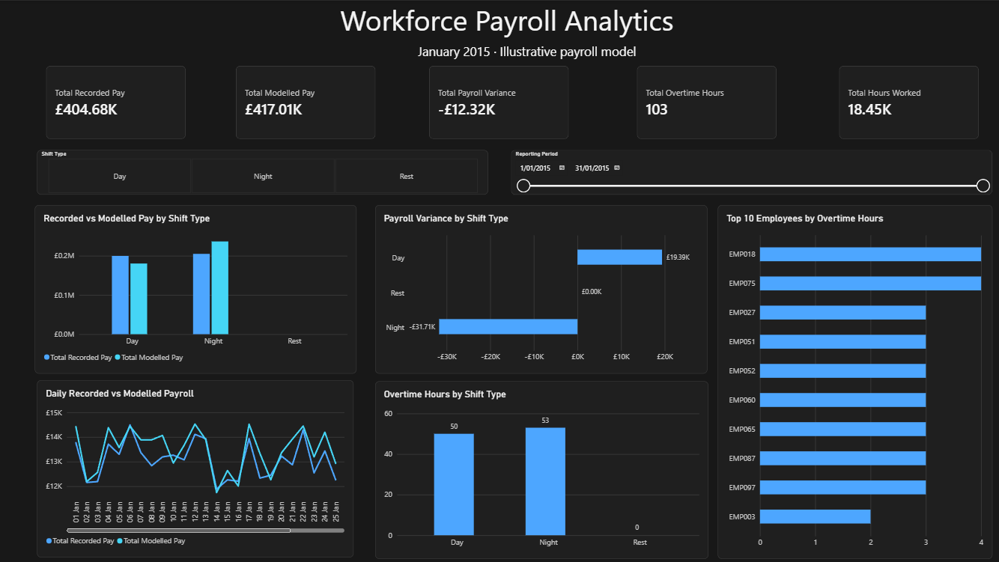

# Workforce Payroll Analytics & Entitlement Validation System

An end-to-end data analytics project using Python, PostgreSQL, SQL, automated testing and Power BI to analyse synthetic workforce shift records, calculate payroll under illustrative rules, validate results and communicate findings through an interactive dashboard.

> **Disclaimer:** This project uses synthetic workforce data and fictional payroll rules for educational and portfolio purposes. Payroll variances represent differences against an illustrative calculation model, not confirmed underpayments, payroll errors or employment award breaches.

## Power BI Dashboard



The interactive dashboard includes:
- Recorded and modelled payroll expenditure
- Net payroll variance
- Total hours worked and overtime hours
- Payroll comparisons and variances by shift type
- Daily payroll trends
- Employee overtime rankings
- Shift-type and reporting-period filters

## Project Objectives

1. Prepare and validate synthetic workforce shift data.
2. Store employee, shift and payroll information in PostgreSQL.
3. Implement a reusable Python payroll calculation engine.
4. Compare recorded pay with pay calculated under illustrative rules.
5. Validate data integrity and payroll reconciliation.
6. Build an interactive Power BI dashboard for workforce analysis.

## Technology Stack

| Technology | Application |
|---|---|
| Python | Data preparation, payroll calculations and analysis |
| pandas | Data transformation and validation |
| PostgreSQL | Relational data storage |
| SQL | Reporting views, queries and integrity checks |
| SQLAlchemy / psycopg2 | Python-to-PostgreSQL integration |
| pytest | Automated unit testing |
| Power BI | Data modelling, DAX and interactive reporting |

## Project Workflow

```text
Synthetic Shift Dataset
        |
        v
Python Data Cleaning
        |
        v
PostgreSQL Database
        |
        v
Python Payroll Calculation Engine
        |
        v
Payroll Results and SQL Validation
        |
        v
PostgreSQL Reporting Views
        |
        v
Power BI Dashboard
```

## Illustrative Payroll Rules

The calculation engine applies the following fictional rules:

| Rule | Value |
|---|---:|
| Base hourly rate | £20.00 |
| Day shift multiplier | 1.00 |
| Night shift multiplier | 1.25 |
| Overtime multiplier | 1.50 |
| Overtime threshold | 8 hours |

Hours exceeding the overtime threshold use the overtime multiplier instead of the ordinary shift multiplier. Rest shifts receive zero modelled pay.

These rules are not intended to represent any actual employment agreement or Australian award.

## Data and Database

The project contains:
- 100 synthetic employee IDs
- 3,100 shift records
- 3,100 modelled payroll results
- Day, Night and Rest shift categories
- A reporting period covering January 2015

The PostgreSQL database includes four core tables:

- `employees`
- `shifts`
- `pay_rules`
- `payroll_results`

Two reporting views support Power BI:

- `vw_payroll_detail`
- `vw_employee_payroll_summary`

## Payroll Calculation and Testing

The Python calculation engine uses decimal arithmetic for monetary precision and handles:
- Ordinary Day and Night shifts
- Overtime thresholds
- Rest shifts
- Invalid shift types and negative hours
- Currency rounding
- Recorded-versus-modelled payroll variance

**Automated testing:** 20 pytest tests passed.

## Validation Results

SQL checks confirmed:

| Validation | Result |
|---|---:|
| Employee records | 100 |
| Shift records | 3,100 |
| Payroll result records | 3,100 |
| Orphaned shifts | 0 |
| Invalid Rest shifts | 0 |
| Invalid working durations | 0 |
| Missing payroll results | 0 |
| Payroll reconciliation errors | 0 |
| Incorrect variance statuses | 0 |

## Key Findings

| Metric | Result |
|---|---:|
| Recorded payroll | £404,684.96 |
| Modelled payroll | £417,005.00 |
| Net variance | -£12,320.04 |
| Total hours worked | 18,448 |
| Total overtime hours | 103 |

Night shifts contributed a larger negative payroll variance than Day shifts under the illustrative model.

Of the 103 overtime hours, 50 occurred during Day shifts and 53 during Night shifts.

These findings describe the synthetic dataset and chosen assumptions; they do not establish actual payroll compliance.

## Repository Structure

```text
workforce-payroll-analytics/
├── data/
│   ├── employees.csv
│   └── shifts.csv
├── notebooks/
│   └── payroll_project.ipynb
├── src/
│   └── payroll_engine.py
├── sql/
│   ├── 01_create_tables.sql
│   ├── 02_insert_pay_rules.sql
│   ├── 03_create_views.sql
│   └── 04_data_validation.sql
├── tests/
│   └── test_payroll_engine.py
├── powerbi/
│   └── Workforce_Payroll_Analytics.pbix
├── docs/
│   └── payroll_dashboard.png
├── requirements.txt
└── README.md
```

## Limitations

- The dataset is synthetic and covers one month.
- Payroll rules are fictional and simplified.
- The model excludes real-world award classifications, allowances, leave entitlements, tax and superannuation.
- Reported variances are scenario comparisons, not verified payroll discrepancies.
- The database reporting view uses a fixed eight-hour overtime threshold, consistent with this illustrative rule set.

## Data Source and Acknowledgements

This project uses the **ShiftsWorked** synthetic dataset from the `deident` R package, developed by Robert Cook, Md Assaduzzaman and Sarahjane Jones.

Original dataset: https://stat-cook.github.io/deident/reference/ShiftsWorked.html

Package repository: https://github.com/Stat-Cook/deident

The original dataset contains 3,100 synthetic shift records and is used here for educational and portfolio purposes.

The `deident` package is distributed under the MIT licence. The original authors retain credit for the source dataset.

The Python payroll calculation engine, PostgreSQL database implementation, SQL validation queries, automated tests and Power BI dashboard were developed as part of this portfolio project.
